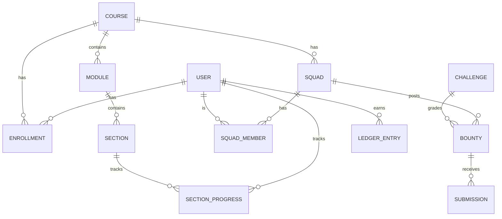

# Tempa architecture

## Request flow

The FastAPI app is a **Backend-for-Frontend (BFF)**: it serves the PWA and is the only thing that decides which content a client may receive.

```mermaid
sequenceDiagram
    participant S as Student (PWA)
    participant B as BFF (FastAPI)
    participant DB as PostgreSQL
    S->>B: GET /api/sections/2 (JWT)
    B->>DB: is section 1 unlocked?
    alt locked
        B-->>S: 423 section_locked (no body content)
    else current
        B->>DB: served_at = now()  (server clock)
        B-->>S: section content + suggested time
    end
    S->>B: POST /complete {scroll_depth, avg_velocity, hidden_ms}
    B->>B: elapsed = now - served_at; evaluate()
    alt rushed
        B-->>S: gate: checkpoint question (no answer)
        S->>B: POST /checkpoint {choice}
        B->>DB: correct → unlock + ledger.append()
    else read properly
        B->>DB: unlock + ledger.append()
    end
```

## Anti-gaming design

| Threat | Mitigation |
|---|---|
| Fetching later lessons directly | Locked sections return `423` with no content; status is derived server-side from progress rows. |
| Faking reading time | Elapsed time uses the server's `served_at`. Client telemetry can only add reasons to gate, never remove them (test: `test_lying_telemetry_cannot_beat_server_clock`). |
| Brute-forcing the checkpoint | A wrong answer closes the gate and restarts the clock; first-try accuracy is recorded for the lecturer. Correct on a retry gives 1 pt instead of 3. |
| Hoarding bounties | Max 2 active claims per student; idle claims return to the board after `CLAIM_TTL_HOURS`. |
| Claiming credit for others' work | Only the claimant can submit; points are awarded to the claimant only when the referee or lecturer verifies. |
| Editing points in the DB | Every ledger row is HMAC-SHA256 signed over its content and the previous row's hash. Any change breaks the chain from that row on. |
| Forged tokens / telemetry | Stateless HS256 JWT on every protected route; role checks for lecturer-only actions. |
| Malicious submitted code | AST allow-list (safe stdlib imports only; no dunder access, `open`, `eval`, `exec`, `getattr`…), separate interpreter in isolated mode (`-I`), stripped environment, temp working dir, timeout, and on Linux memory/CPU rlimits. **Production:** run the same harness inside a throwaway gVisor/Firecracker container with no network. |
| Leaking hidden tests | Hidden test inputs/expected values are never serialised; only pass/fail (and an exception type) is returned. |

## Adaptive pacing

```
min_dwell = max(MIN_DWELL_SECONDS, words / READING_WPM × 60 × factor)
factor    = 0.35 trusted  (≥4 recent unlocks, zero rushes)
            0.50 steady
            0.75 rushing  (≥3 rush events in the last 8 unlocks)
```

Gate reasons: `too_fast`, `not_scrolled` (< 85% depth), `skimming` (avg scroll > 6000 px/s), `tab_away` (> 50% of time hidden).

## Accountability maths

- Fair share = 1 / squad size.
- **Coasting**: verified share < 0.5 × fair share. **Carrying**: > 1.5 × fair share. Flags only show once the squad has earned at least 20 points, so nobody is flagged on day one.
- **Competence** for matching = lifetime ledger points, with bounties weighted ×2.
- **Balanced matching**: snake draft over ranked students. **Tiered**: contiguous blocks of similar competence.

## Data model



## API surface

Full interactive docs at `/docs` (Swagger) and `/redoc`.

| Method | Path | Who |
|---|---|---|
| POST | `/api/auth/register`, `/api/auth/login` | public |
| GET | `/api/courses`, `/api/home` | any |
| GET | `/api/courses/{id}/modules`, `/api/modules/{id}`, `/api/sections/{id}` | enrolled |
| POST | `/api/sections/{id}/complete`, `/api/sections/{id}/checkpoint` | enrolled |
| GET | `/api/courses/{id}/my-squads`, `/api/squads/{id}/board`, `/api/bounties/{id}` | squad member / lecturer |
| POST | `/api/bounties/{id}/claim`, `/release`, `/submit` | squad member |
| POST | `/api/challenges/{slug}/run` | any (visible tests only) |
| POST | `/api/bounties/{id}/review`, `/api/squads/{id}/bounties` | course lecturer |
| GET | `/api/courses/{id}/dashboard` | course lecturer |
| POST | `/api/courses/{id}/match` | course lecturer |
| GET | `/api/transcript/me` | student |
| GET | `/api/public/transcript/{public_id}` | public (employers) |

## Scaling path

- The API is stateless (JWT), so it scales horizontally behind a load balancer; PostgreSQL holds all state.
- Sandbox grading moves to a job queue (e.g. Redis + workers in isolated containers) so slow submissions never block API workers.
- Read-heavy views (dashboard, transcript) can be cached per course and invalidated when a ledger entry is written.
- Content authoring: lecturers add modules, sections and checkpoints; curriculum tags can map to MOE's DSKP for school deployments.
